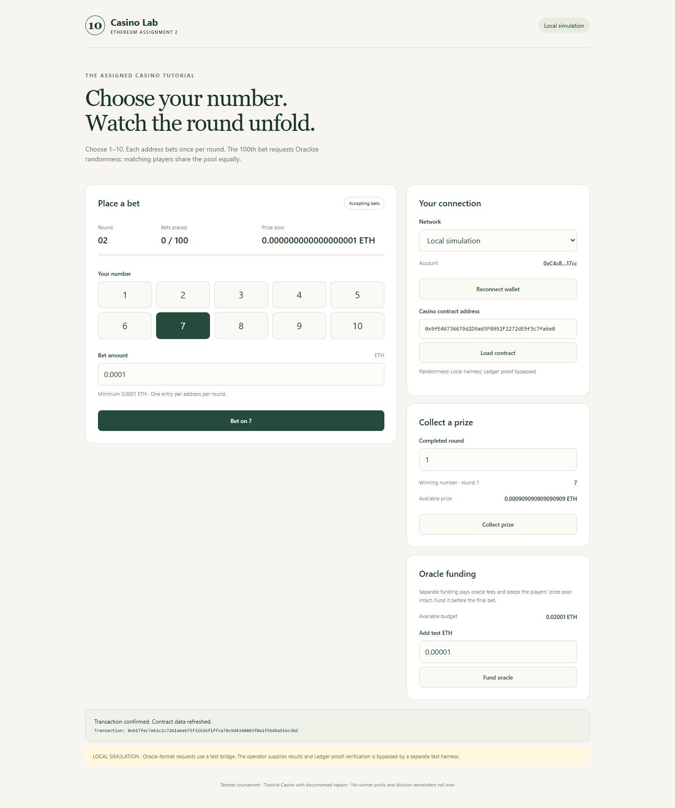
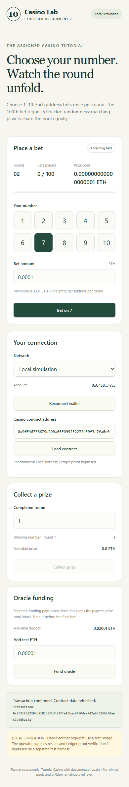

# Verification of the tutorial-based revision

Date: 7 October 2026. Solidity 0.4.22, optimization enabled with 200 runs, Byzantium target. The original API emits legacy deprecation warnings; compilation succeeds.

## Automated contract tests

Result: **7 passed, 0 failed**.

1. Invalid configuration, number boundaries, minimum amount and duplicate entries.
2. A complete 100-distinct-address round, automatic query, separately charged oracle fee, equal winner shares, claims and next-round reentry.
3. A no-winner round and integer division remainder rollover.
4. Insufficient oracle budget atomically rejects the final bet; funding allows resubmission without consuming the pool.
5. The production Casino rejects an empty Ledger proof; the local harness rejects unauthorized callbacks. This is a negative proof test, not a valid-proof verification test.
6. A rejecting recipient can redirect its prize without losing its entitlement.
7. A receiver cannot collect again by reentry.

## Browser and build checks

The browser uses an injected EIP-1193 test-wallet adapter connected to a local chain with 110 disposable accounts. It is not a test of the real MetaMask extension.

Passed: loading the tutorial-style contract fields; below-minimum amount; cancellation; confirmed bet; duplicate-entry blocking; separate oracle funding; 100 distinct bets and automatic query; local simulated callback; displayed winning number; prize collection and next round; 390-pixel viewport without horizontal overflow; wallet account-change reset. No browser exceptions were observed.

The static production build succeeds. Its local simulation deployment JSON is excluded. The bundle also passed asset loading, mobile layout and browser exception checks when served beneath a simulated `/ipfs/local-preview/` gateway path. This does not publish or pin any IPFS content.

Local screenshots:

## Read-only Sepolia check

The pinned dependency's resolver `0x14B31A1C66a9f3D18DFaC2d123FE8cE5847b7F85` has code and returned `0xC7C56b6da8a9B59fE994A87ffB8f435770EC71fe`. That oracle also has code and returned a price, but `cbAddress` was zero and `randomDS_getSessionPubKeyHash` reverted with `InvalidFEOpcode`.

The snapshot is `SEPOLIA_READ_CHECK.json`. This is an observed failure of the currently resolved random-datasource interface; it does not establish that every provider configuration is unavailable. No transaction or real randomness request was submitted. The public exercise remains blocked pending resolution of these checks or an instructor-approved alternative.

Local settlement uses the separate test harness, which skips Ledger proof verification. Its successful callback is not evidence that the production callback can receive and verify a live Ledger proof.
